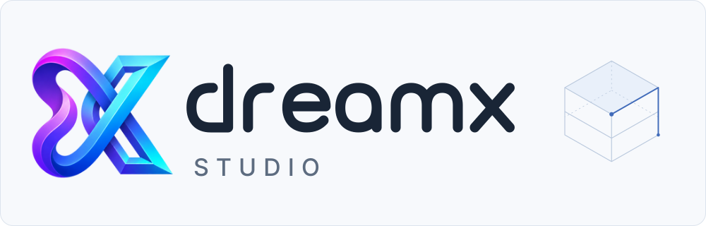

<picture>
  <source media="(prefers-color-scheme: dark)" srcset="https://raw.githubusercontent.com/DreamX-Studio/.github/main/assets/studio-dark.svg">
  
</picture>

We’re a development studio in **Vietnam** building 3D multiplayer games and developer tools. Our team sets the direction and reviews the work that AI agents help implement.

## Projects

<table>
  <tr>
    <td width="64" align="center"></td>
    <td><strong>3D multiplayer game</strong> In development with the Godot engine.</td>
  </tr>
  <tr>
    <td width="64" align="center"></td>
    <td><strong>DX MOP</strong> A native desktop workspace where our team coordinates AI agents, reviews plans and verifies results. Currently in pilot on Linux.</td>
  </tr>
  <tr>
    <td width="64" align="center"></td>
    <td><strong>DX Relay</strong> An internal studio project.</td>
  </tr>
</table>

## For studio members

Start with the workspace setup guide, shared working rules and project directory in [dx-studio (team access)](https://github.com/DreamX-Studio/dx-studio).
